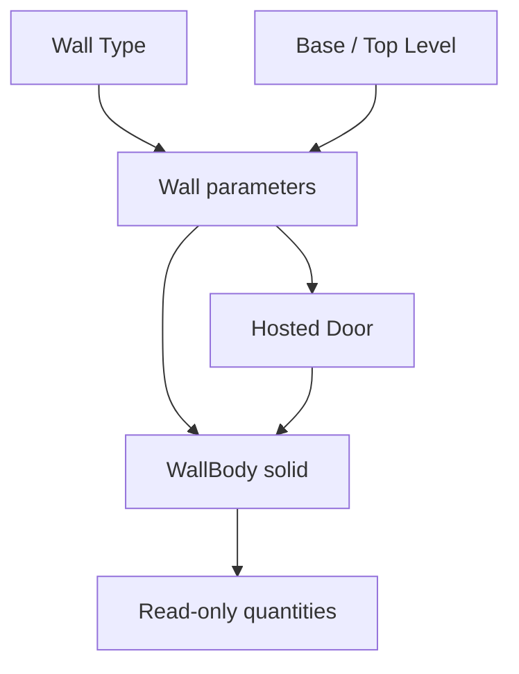

# v0.2.0 — Walls and Hosted Doors

> เอกสารนี้อธิบายสัญญา Wall/Door ตั้งแต่ v0.2.0 สำหรับ v0.5.0 มี native Material/layers และ Door/Window shared Type เพิ่มแล้วตาม [Types and Quantities](TYPES_AND_QUANTITIES.md) ข้อความเรื่องยังไม่มี catalogue/layers ด้านล่างอ้างถึงขอบเขตรุ่นเดิม.


3117 BIM Studio เพิ่มการสร้างผนังและประตูจาก Foundation โดยใช้ **FreeCAD Document / `.FCStd` ชุดเดียว** เป็นข้อมูลหลัก รุ่นนี้เป็น development candidate สำหรับ FreeCAD 1.1.4; อ่านผลที่รันจริงใน [VERIFICATION.md](VERIFICATION.md) และ gate Windows ใน [WINDOWS_ACCEPTANCE.md](WINDOWS_ACCEPTANCE.md)

## 1. Workflow ที่เพิ่ม

1. **Create Project** พร้อม L00 = 0 mm และ L01 = 3000 mm
2. **Create Wall Type** เช่น `W200` ความหนา 200 mm และชื่อวัสดุประกอบข้อมูล
3. **Create Wall** เลือก W200, Base Level = L00, Top Level = L01 แล้วระบุจุดเริ่มและจุดปลาย X/Y
4. **Create Door** เลือกผนัง ระบุ Offset จากจุดเริ่มผนัง, Width, Height และ Sill
5. **Edit Selected** ของ Type, Level, Wall หรือ Door แล้วตรวจรูปทรงที่สัมพันธ์กัน
6. ใช้ **Undo / Redo** ของ FreeCAD และบันทึกเป็น `.FCStd`

ฟอร์มใช้หน่วย **มิลลิเมตร** การสร้างด้วยเมาส์และ snapping ยังเป็นงานต่อไป ในรุ่นนี้ให้ระบุตัวเลขในฟอร์มเพื่อสร้างแนวผนังที่ตรวจตำแหน่งได้แน่นอน

## 2. Type และ Instance

| รายการ | ข้อมูลที่ผู้ใช้แก้ | ผลต่อโมเดล |
|---|---|---|
| Wall Type | ชื่อ, Thickness, Material | เมื่อแก้ Thickness ผนังทุก instance ที่อ้างอิง type เปลี่ยนความหนาและสร้างช่องเปิดใหม่ |
| Wall | Type, Base/Top Level, Base/Top Offset, Start X/Y, End X/Y | รูปทรงผนังและประตูที่ผูกกับผนังเคลื่อนหรือเปลี่ยนขนาดตาม |
| Door | Host Wall, Offset, Width, Height, Sill | ตำแหน่ง/ขนาดช่องเปิดและกรอบแสดงผลเปลี่ยนตาม |
| Level | Elevation | ฐาน/ยอดผนัง และ datum/grid ที่อ้างอิงระดับคำนวณใหม่ |

`Material` เป็นข้อความระบุวัสดุของ type ยังไม่ใช่ material layers, ราคาหรือคุณสมบัติคำนวณโครงสร้าง Door ในรุ่นนี้เป็น instance ที่มีช่องเปิดสี่เหลี่ยมและกรอบแสดงผล ไม่มี Door Type catalogue, บานพับ, handing, swing หรือ Family Editor

การแก้ Thickness ของ Wall Type ใช้ร่วมกันทุก instance ที่อ้างอิง ส่วนการเลือก type ใหม่ใน Wall หนึ่งชิ้นเปลี่ยนเฉพาะ instance นั้น ไม่เปลี่ยน type ของผนังอื่น

## 3. แนวผนังและพิกัด

จุด `(StartX, StartY)` และ `(EndX, EndY)` คือแนวอ้างอิงด้านหนึ่งของผนัง ไม่ใช่แนวกึ่งกลาง ระบบพิกัดยังเป็น local project origin `(0, 0, 0)` และ Z ชี้ขึ้นตาม Foundation

- แกน X ท้องถิ่นวิ่งจากจุดเริ่มไปจุดปลาย
- ความหนาอยู่ด้าน **+Y ท้องถิ่น** หรือด้านซ้ายเมื่อมองตามทิศทาง start → end
- เมื่อผนังวิ่งจาก `(0, 0)` ไป `(6000, 0)` ความหนา 200 mm จะกินช่วง Y = 0 ถึง 200 mm
- Door Offset วัดตามแนวผนังจากจุดเริ่มถึงขอบแรกของช่องเปิด ไม่ใช่ระยะถึงกึ่งกลางช่อง
- Door Sill วัดจากฐานจริงของผนังหลังรวม Base Offset

**Door Width/Height คือขนาดช่องที่ตัดเนื้อผนังทั้งหมด รวมพื้นที่กรอบแสดงผล** ไม่ใช่ขนาดบานหรือช่องผ่านสุทธิ กรอบทั่วไปมีแถบวงกบสองข้างและทับหลังอยู่ภายในช่อง เช่น ช่อง 900 × 2100 mm ในตัวอย่างใช้แถบกรอบ 50 mm จึงเหลือช่องว่างภายในกรอบประมาณ 800 × 2050 mm ความหนาแถบกรอบลดตามขนาดเมื่อช่องเล็กมาก และยังไม่ได้เปิดเป็นพารามิเตอร์ Family

การกลับทิศ start/end จึงเปลี่ยนด้านความหนาและทิศวัด offset ด้วย เป็นผลตามพิกัดที่ประกาศไว้ ไม่ใช่การสลับด้านอัตโนมัติ ใช้ Edit Selected แก้ start/end หลายค่าพร้อมกันในหนึ่งคำสั่ง

ความสูงจริงคำนวณจาก:

```text
BaseZ = BaseLevel.Elevation + BaseOffset
TopZ = TopLevel.Elevation + TopOffset
Height = TopZ - BaseZ
```

รุ่นนี้ต้องเลือก Base Level และ Top Level ทั้งคู่ ไม่ใช้ Unconnected Height ควบคุมร่วมกัน ความสูง ความหนา และความยาวต้องเป็นบวก พร้อมตรวจว่าช่องเปิดยังอยู่ในผนัง

## 4. ช่องเปิดจริงและการคำนวณตามความสัมพันธ์

ผนังใช้ solid ของ FreeCAD/OCCT ช่องเปิดถูกตัดออกจากเนื้อผนังด้วย boolean operation กรอบ Door เป็นรูปทรงแสดงตำแหน่งอีกชิ้นหนึ่งและไม่ถูกนับรวมในปริมาตรสุทธิของผนัง การซ่อน Door จึงยังเห็นช่องเปิดของผนังอยู่

Dependency graph แยกข้อมูล Wall ออกจากผลรูปทรง WallBody เพื่อให้ผนังใช้ข้อมูลประตูตัดช่องเปิดได้โดยไม่เกิดวงจร Wall → Door → Wall:



Wall คือองค์ประกอบที่ผู้ใช้สร้างและแก้ไข WallBody เป็นผลคำนวณที่สร้างและจัดการพร้อม Wall ใช้ UUID ของ Wall เป็น identity สำหรับการเชื่อมข้อมูล BIM ในงานต่อไป อย่านับ Wall และ WallBody เป็นผนังสองชิ้น เมื่อคลิกผิวของ WallBody แล้วกด Edit Selected ระบบจะพาไปแก้ Wall ที่เป็นเจ้าของ

## 5. ข้อมูล native ที่บันทึกใน FCStd

| Kind | Native object | Properties สำคัญ |
|---|---|---|
| WallType | App::FeaturePython | Thickness, Material, Project, UUID |
| Wall | App::FeaturePython | WallType, BaseLevel, TopLevel, StartX/Y, EndX/Y, BaseOffset, TopOffset, Body |
| Door | Part::FeaturePython | Host, Offset, Width, Height, Sill, Shape |
| WallBody | Part::FeaturePython | Wall, Openings, Shape และปริมาณที่คำนวณแล้ว |

Project เก็บสมาชิกทุกชนิดผ่าน group ส่วน parent backlinks ที่ไม่ใช่ตัวขับ geometry ใช้ hidden links วัตถุแต่ละชิ้นยังมี `BIM3117Id`, `BIM3117Kind`, schema และ version การสร้าง ถ้า native reference ขาด ระบบต้องรายงาน invalid state; ไม่สร้าง identity ใหม่หรือเลือก host/level อื่นแทนโดยเงียบ

Schema ของ Foundation ยังเป็น 1 ชนิดใหม่เพิ่มใน namespace เดิมเพื่อให้ไฟล์ Foundation v0.1 เปิดต่อได้ การเปิดไฟล์ที่มี Wall/Door ของ v0.2 ต้องใช้ Workbench v0.2 ที่รองรับชนิดเหล่านี้ การคืนรุ่น Workbench เป็น v0.1 ไม่ใช่การแปลงไฟล์ v0.2 กลับไปเป็น v0.1

## 6. การแก้ไข การลบ และ transaction

หนึ่งคำสั่งสร้าง/แก้/ลบใช้หนึ่ง document transaction ของ FreeCAD ตรวจข้อมูลก่อนและหลัง recompute แล้ว commit หรือ rollback ทั้งชุด จึงใช้ Ctrl+Z / Ctrl+Y ชุดเดียวกับ host

| การกระทำ | นโยบาย |
|---|---|
| เปลี่ยน Wall Type thickness | ทุก instance และช่องเปิดสร้างรูปทรงใหม่ |
| เปลี่ยน Level จน Door สูงเกินผนัง | ปฏิเสธและคืนค่าของคำสั่ง |
| ลดความยาวผนังจน Door เลยปลาย | ปฏิเสธและคืนค่าของคำสั่ง |
| สร้าง Door ซ้อนกับช่องเดิม | ปฏิเสธ; ไม่เหลือ object หรือ undo item ของคำสั่งที่ล้มเหลว |
| เปลี่ยน Door Host | ช่องผนังเดิมปิดและผนังใหม่ถูกตัดในคำสั่งเดียว |
| ลบ Door ผ่าน Delete Selected | ช่องเปิดเดิมปิด; Undo คืน Door และช่องเปิด |
| ลบ Wall ที่ยังมี Door | ปฏิเสธ ให้ลบหรือย้าย Door ก่อน |
| ลบ Wall ที่ไม่มี Door | ลบ authored Wall และ derived WallBody พร้อมกัน |
| ลบ Type/Level ที่มีผนังอ้างอิง | ปฏิเสธ ให้เปลี่ยน references ก่อน |
| ลบ WallBody แยกเดี่ยว | ไม่ใช่ workflow ที่รองรับ ให้เลือก Wall แล้วใช้ Delete Selected |

ใช้ฟอร์มเพื่อเปลี่ยนหลายค่าที่สัมพันธ์กัน เช่น เปลี่ยนแนวผนังหรือย้าย Host Native Properties รองรับการแก้ค่าที่เปิดให้แก้ทีละค่าและใช้ transaction ของ host การแก้โครงสร้าง Group, คัดลอก native object ดิบ, ลบผ่าน Python console หรือแก้ properties ที่ล็อกไว้ยังอยู่นอก workflow ที่รองรับ ตัวตรวจเอกสารช่วยตรวจ reference, UUID และสมาชิกกลุ่มที่ไม่สอดคล้องกัน

## 7. ปริมาณพื้นฐานของ WallBody

ค่าต่อไปนี้เป็น output ที่สร้างใหม่จาก wall parameters และช่องเปิด ไม่ใช่ค่าให้ผู้ใช้กรอกแทน geometry:

| Property | ความหมาย | หน่วยภายใน host |
|---|---|---|
| GrossSideArea | พื้นที่ด้านข้างหนึ่งด้านก่อนหักช่อง | mm² |
| NetSideArea | พื้นที่ด้านข้างหนึ่งด้านหลังหักช่อง | mm² |
| GrossVolume | ปริมาตรผนังเดี่ยวก่อนหักช่อง | mm³ |
| OpeningVolume | ปริมาตรเนื้อผนังที่หักช่องเปิด | mm³ |
| NetVolume | ปริมาตรสุทธิของผนัง | mm³ |

แปลง mm² เป็น m² ด้วยการหาร 1,000,000 และ mm³ เป็น m³ ด้วยการหาร 1,000,000,000 GUI อาจเลือกแสดงหน่วยตาม FreeCAD preferences แต่ค่าฐานและขนาดจริงไม่เปลี่ยน

Fixture อิสระสำหรับตรวจผล: ผนังยาว 6,000 mm สูง 3,000 mm หนา 200 mm มี Door กว้าง 900 mm สูง 2,100 mm:

| ค่า | ผลที่ต้องได้ |
|---|---:|
| Gross side area | 18.000 m² |
| Opening area | 1.890 m² |
| Net side area | 16.110 m² |
| Gross volume | 3.600 m³ |
| Opening volume | 0.378 m³ |
| Net volume | 3.222 m³ |
| Net volume เมื่อ Top Level เปลี่ยนเป็น 3,300 mm | 3.582 m³ |

ตัวเลขนี้เป็นกฎผนังตรงหนาสม่ำเสมอแต่ละ instance ยังไม่รวมการหักปริมาตรทับซ้อนที่รอยต่อผนัง ไม่มี wall joins, layered materials, BOQ pricing หรือ live schedule ในรุ่นนี้

## 8. ตัวอย่าง API ใน FreeCAD Python console

ตัวเลขใน API นี้เป็น mm ใช้หลังติดตั้งและ restart FreeCAD แล้ว:

```python
from bim3117_freecad import services

project = services.create_project("3117 Wall Door Demo")
base, top = services.list_levels(project)
wall_type = services.create_wall_type(project, "W200", thickness_mm=200,
                                      material="Generic masonry")
wall = services.create_wall(
    project, "W01", wall_type=wall_type, base_level=base, top_level=top,
    start_x_mm=0, start_y_mm=0, end_x_mm=6000, end_y_mm=0,
)
door = services.create_door(
    project, "D01", host=wall, offset_mm=1200,
    width_mm=900, height_mm=2100, sill_mm=0,
)
body = services.wall_body(wall)
print(body.Shape.Volume / 1_000_000_000)  # 3.222 m³

services.edit_level(top, elevation_mm=3300)
print(body.Shape.Volume / 1_000_000_000)  # 3.582 m³
project.Document.undo()
project.Document.recompute()
```

อย่าเปิด document transaction ครอบ service เหล่านี้อีกชั้น เพราะ service เป็นเจ้าของ transaction ของคำสั่งอยู่แล้ว ใช้ชุดทดสอบ host ที่แนบมาเพื่อตรวจสภาพแวดล้อมจริงของเครื่อง

## 9. ตรวจการติดตั้งและไฟล์ตัวอย่าง

- ตัวอย่าง: `examples/freecad/Architecture_Workbench.FCStd`
- ภาพจาก FreeCAD GUI: `examples/freecad/Architecture_Workbench.png`
- GUI smoke: `Run_3117_Architecture_Test.FCMacro` ใน ZIP หรือตำแหน่ง `packaging/` ใน source
- Native host: `tests/freecad_architecture.py` และ `tests/freecad_architecture_reopen.py`
- GUI/fresh GUI: `tests/freecad_architecture_gui.py` และ `tests/freecad_architecture_gui_reopen.py`

การรัน macro สำเร็จพิสูจน์เฉพาะรายการที่รายงานบนเครื่องนั้น ต้องบันทึก OS/FreeCAD/Python/Qt และผลรายงาน ไม่ถือว่าผ่านทุกแพลตฟอร์มตามกัน

## 10. งานที่ต่อจากรุ่นนี้

ลำดับถัดไปคือเชื่อมปริมาณที่ตรวจได้เข้ากับ rows/CSV และ model revision แล้วเชื่อมแปลน/รูปตัด/ตารางกับ document เดียวกัน เพิ่ม wall joins และหมวดอาคารอื่นด้วยกฎ geometry/quantity เฉพาะ Native IFC export จะเชื่อมกับวัตถุชุดนี้ภายหลังผ่าน mapping และ coverage gate; reference IFC exporter เดิมยังเป็นคนละส่วน

แหล่งข้อมูลกลไก host: [FreeCAD 1.1.4](https://github.com/FreeCAD/FreeCAD/releases/tag/1.1.4), [TopoShape source API](https://freecad.github.io/SourceDoc/d8/ded/classPart_1_1TopoShape.html), [Document source API](https://freecad.github.io/SourceDoc/d8/d3e/classApp_1_1Document.html) ตรวจสอบ 2026-10-23 สถาปัตยกรรมและนโยบาย authoring ในเอกสารนี้เป็นการออกแบบของโครงการ; หลักฐานพฤติกรรมอยู่ในรายงาน host ของรุ่นที่ส่งมอบ
